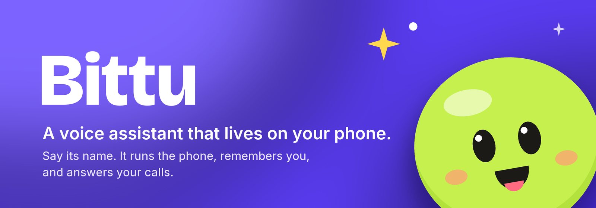
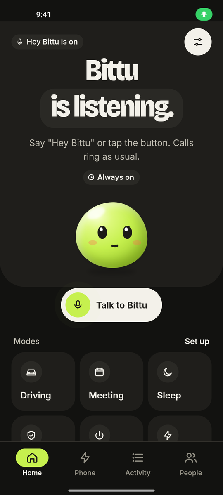
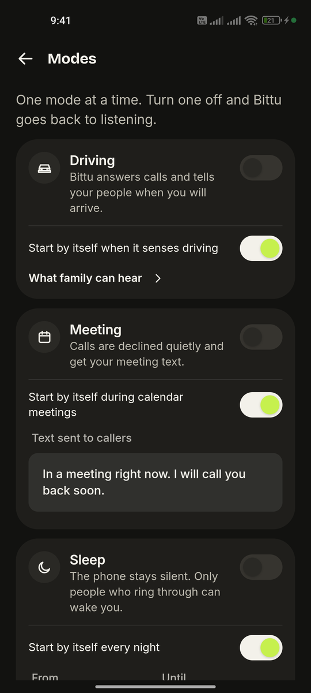
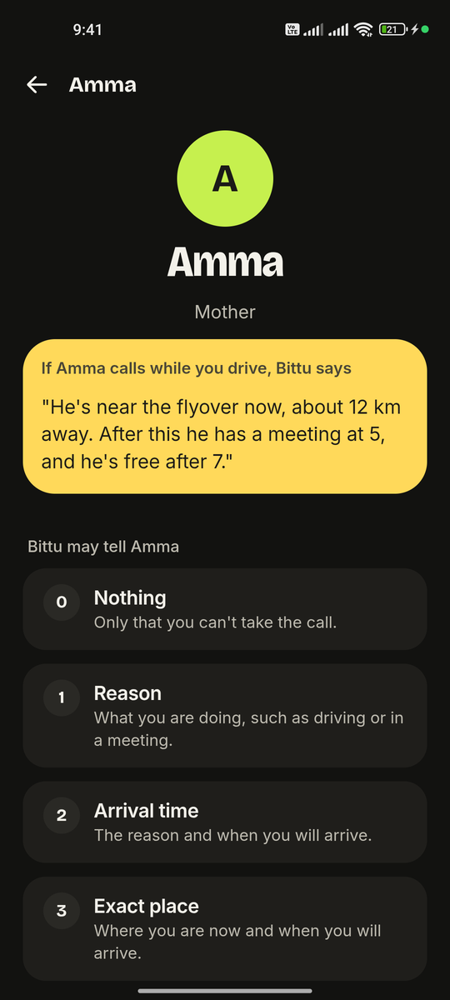
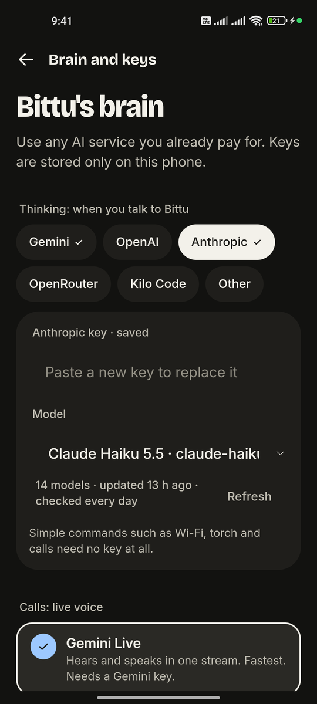
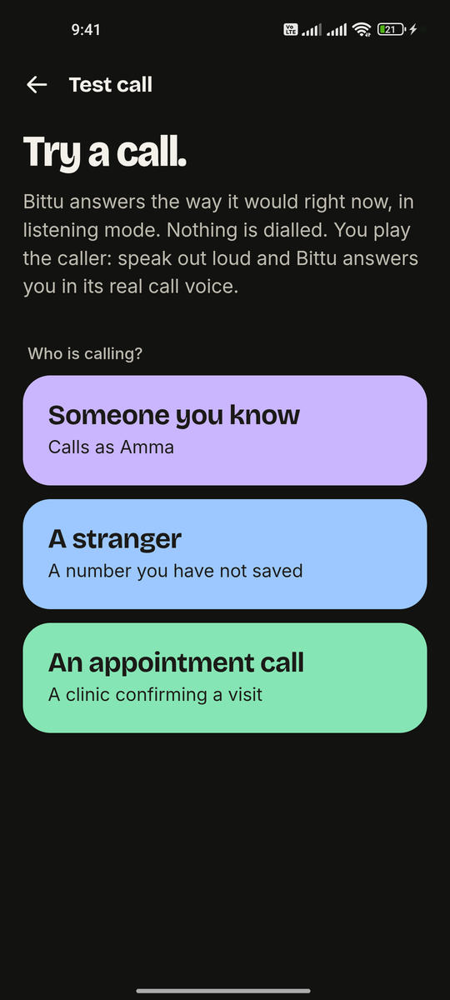

<p align="center">
  
</p>

<p align="center">
  <a href="https://github.com/hari7993/bittu/releases/latest"><b>Download the app</b></a>
  &nbsp;·&nbsp; <a href="#bittu-answers-your-calls">Answers your calls</a>
  &nbsp;·&nbsp; <a href="#what-bittu-does">What it does</a>
  &nbsp;·&nbsp; <a href="#ai-services-bittu-works-with">AI services</a>
  &nbsp;·&nbsp; <a href="#every-permission-and-why">Permissions</a>
  &nbsp;·&nbsp; <a href="#install">Install</a>
</p>

# Bittu

Bittu is our voice assistant for Android, and its main job is this: **when we can't pick up, Bittu answers the
call for us and talks to the caller.** It lives on the phone itself. We say "Bittu" and it also runs the phone,
answers questions and remembers what we tell it.

We built it because we wanted an assistant that is really ours: no Bittu server, no account, no call forwarding.
Everything runs on the phone. The only things that leave it are the requests to the AI services we chose and
added keys for.

<p align="center">
  
  
  
  
  
</p>

<p align="center"><sub>Home · Modes · Who hears what · Brain and keys · Try a call. The names in these pictures are examples.</sub></p>

## Bittu answers your calls

> **You are driving, in a meeting or asleep. The phone rings. Bittu picks up and speaks to the caller for you.**

This is what Bittu is built around. You switch on a mode, and from then on:

1. **It lets the phone ring for you first**, for as long as you set. If you pick up, Bittu stays out.
2. **It answers and talks**, in a natural voice, live. It knows who is calling from your contacts and greets them
   by name, in Telugu for people you have saved and in English for others, then follows the caller's language.
3. **It tells each caller only what you allow.** A stranger hears that you can't take the call. Family can ask
   where you are and when you will be free.
4. **It takes the message**, and if it is urgent it buzzes your phone so you can take the call over.
5. **It hangs up politely and leaves you a summary**: who called, what they wanted, what you need to do.

| Mode | What Bittu does with a call |
|---|---|
| **Driving** | Answers, says you are driving, takes a message |
| **Meeting** | Silences the ringer, answers, says you are in a meeting, takes a message |
| **Sleep** | Silences the ringer and answers; people you marked can still ring through |
| **Strangers** | Answers only numbers you have not saved and asks what they want |
| **Your own modes** | You write the sentence, for example "playing cricket, back after 6", and choose answer or decline |
| **Off** | Bittu does nothing; calls ring as usual |

A mode can run until you switch it off, or for a set time such as "for 1 hour" or "until 7 AM", and it ends by itself.

All of this happens on your own phone, on your own number. There is no call forwarding and no second number.

**In one minute**

| You say or do | Bittu does |
|---|---|
| "Bittu, open YouTube" | Opens it at once, with no AI call |
| "Bittu, send this to Akka on WhatsApp" | Reads the screen, taps share, finds her, sends |
| "Bittu, what's the weather today?" | Finds where you are, searches, answers in a sentence |
| "I go to the gym every morning at six" | Remembers it, and still knows next month |
| Turn on Driving mode | Picks up your calls, talks to the caller, leaves you a summary |
| Amma calls while you drive | Greets her in Telugu, tells her what she asks, and can buzz you to take over |

## What Bittu does

**Answering calls**
- In a mode such as Driving, Bittu rings us first, then picks up and talks to the caller live.
- It knows the caller from our contacts, greets saved contacts in Telugu and others in English, then follows the
  caller's language.
- It takes a message, can buzz our phone so we take the call over, and leaves a summary notification afterwards.
- If the live voice service cannot be reached, it carries on with a three-step backup: hear, think, speak.

**Talking to Bittu**
- Wake word: say "Bittu" at any time, also from the lock screen. Follow-up sentences within 12 seconds need no name.
- Plain commands run at once with no AI call at all: open an app, torch, Wi-Fi, Bluetooth, volume, brightness,
  home, back, scroll, modes. Most take under 0.2 seconds.
- Common tasks skip the app's screens altogether and use one direct link: a WhatsApp message to a contact, a call,
  directions in Maps, a YouTube search, an alarm, a timer. "Send hi to Amma on WhatsApp" is one link and one tap.
- **It learns.** The first time you ask for something inside an app, the AI works it out step by step. When it
  succeeds, Bittu saves the steps as a skill, with the name or message left blank. The next request of the same
  shape is replayed directly with no AI call (6 seconds became 1.2 in our test). If a step does not find what it
  expects, the replay stops and the AI takes over, so a changed screen costs time but not a wrong tap.
- Apps open by the name you say, however the recognizer spells it: "phone pay", "google pay", "watsapp".
- Everything else goes to the AI with tools: call a person, send a message, read and tap what is on the screen in
  any app, read and reply to notifications, look things up on the internet, find where the phone is, read the
  phone's own details, run any shell command.
- It speaks with the phone's own voice, ElevenLabs or Fish Audio.

**Modes**
- Driving, Meeting, Sleep, Strangers, Off, and modes we make ourselves with our own sentence for callers.
- A mode can run for a set time ("for 1 hour", "until 7 AM") and ends by itself.

**Who hears what**
- Each person has a sharing level, from "nothing" to "everything".
- Family, listed by exact phone number, may ask where we are, what we are doing next and what is in our calendar.
  Bittu answers only what they ask and never volunteers it.
- What a caller is not allowed to hear is left out of the AI's instructions entirely, so it cannot be talked out of it.

**Memory**
- It starts empty. Bittu saves what we tell it about ourselves, our people and our routines, and keeps a diary
  line for each conversation.
- There is no limit: recent notes are folded into a short profile automatically, and the originals are kept for
  look-up.
- It is stored only in the app's private storage. A Memory page shows it and can erase one item or all of it.

## AI services Bittu works with

We did not want to be tied to one company, so Bittu takes whichever keys you have. Model and voice lists are
loaded from each service with your own key and refreshed every day, so new models appear by themselves.

| Service | What Bittu uses it for |
|---|---|
| **Anthropic (Claude)** | The assistant that listens to you and acts with tools; memory; thinking in the call backup |
| **Google Gemini** | The assistant with tools; Gemini Live for talking on calls; internet search; call summaries; thinking in the call backup |
| **OpenAI** | The assistant with tools |
| **OpenRouter** | The assistant with tools, with any model it offers that can use tools |
| **Kilo Code** | The assistant with tools: enter its address and model name |
| **Any service that speaks the OpenAI format** | The assistant with tools: enter its address and model name |
| **ElevenLabs** | Bittu's voice; hearing the caller in the call backup |
| **Fish Audio** | Bittu's voice (its `s2.1-pro-free` model costs nothing within fair-use limits); hearing the caller in the call backup |
| **AssemblyAI** | Hearing the caller in the call backup (Hindi and English) |
| **The phone itself** | Hearing "Bittu" and your words with Android's on-device recognizer, and speaking with the phone's own voice. Free, no key. |

You choose which service the assistant thinks with, in **Brain and keys**. Whichever you pick gets the same tools,
the same instructions and the same memory. We run it on Claude and have tested it on Gemini; the OpenAI-format path
(OpenAI, OpenRouter, Kilo Code and others) is built the same way but we have not had a key to try it with yet. Live
calls run on Gemini Live. The backup chain for calls mixes whatever is available: hear with ElevenLabs, Fish Audio
or AssemblyAI; think with Claude or Gemini; speak with ElevenLabs or Fish Audio.

You pay each service directly with your own key. Keys are kept in the app's private storage and are sent only to
the service they belong to.

## How we built it

| Part | What it is |
|---|---|
| `ui/` | The interface: plain HTML, CSS and JavaScript modules, no framework and no build step. It runs in a WebView. |
| `android/` | The app: Kotlin, no UI toolkit. It hosts the WebView and holds every background part. |
| `android/.../shell/` | The **helper**: a small program that runs as Android's `shell` user, started through the phone's own Wireless debugging, the way Shizuku is. |
| `probe/` | Our test tools: a regression check that drives the real phone, and a call-audio probe. |

**Why a helper?** An ordinary app cannot put sound into a phone call, hear the caller, flip protected switches or
answer a call silently. Android's `shell` user can. The app pairs once with the phone's Wireless debugging and from
then on starts the helper by itself, with no computer. The helper puts Bittu's voice straight onto the call line
and reads the caller's side from it.

The helper lives inside Android's debugging service, so Android stops it whenever that service restarts (plugging a
cable or charger in or out does this). Bittu notices and starts it again within about 10 seconds, also when the
phone is locked and asleep.

## Every permission, and why

Bittu asks for a lot, because its job is to operate the whole phone for its owner. None of it is used for
advertising or analytics; there is none in the code.

| Permission | Why Bittu needs it |
|---|---|
| Microphone (`RECORD_AUDIO`, `FOREGROUND_SERVICE_MICROPHONE`) | To hear "Bittu" and your request. Listening uses Android's on-device recognizer; the sound of the wake-word loop is not sent anywhere. |
| Contacts (`READ_CONTACTS`) | To call or message a person by name, and to know who is calling. |
| Phone (`READ_PHONE_STATE`, `CALL_PHONE`) | To notice a ringing call and to place calls you ask for. |
| SMS (`SEND_SMS`) | To send the text you dictate, and your own text when a mode you made is set to decline calls. |
| Location, including background (`ACCESS_FINE_LOCATION`, `ACCESS_COARSE_LOCATION`, `ACCESS_BACKGROUND_LOCATION`) | For "where am I", weather, and to tell family where you are **when they ask and you allowed it**. Background access is needed because a call can arrive while the app is closed. |
| Calendar (`READ_CALENDAR`) | To tell callers with full access what you have planned today and tomorrow, when they ask. Read-only. |
| Notifications (`POST_NOTIFICATIONS`) | The "listening" notice Android requires, call summaries, and the take-over alert. |
| Notification access (a setting you switch on) | To read your notifications aloud and reply to messages from them. |
| Accessibility (a setting you switch on) | "Screen control": to read, tap, type and scroll inside other apps when you ask ("send this to Akka"). See the note on payment apps below. |
| Internet, network state (`INTERNET`, `ACCESS_NETWORK_STATE`, `ACCESS_WIFI_STATE`, `CHANGE_WIFI_MULTICAST_STATE`) | To reach the AI services, and to find the phone's own Wireless debugging on the local network for pairing. |
| Run at start-up, stay awake, exact alarms (`RECEIVE_BOOT_COMPLETED`, `WAKE_LOCK`, `SCHEDULE_EXACT_ALARM`, `FOREGROUND_SERVICE`) | To keep listening in the background, restart the helper while the phone sleeps, and end a timed mode on the minute. |
| Vibrate (`VIBRATE`) | Bittu buzzes instead of beeping when it has heard its name. |
| Secure settings (`WRITE_SECURE_SETTINGS`) | Granted by the helper, not by a prompt. It lets the app switch Wireless debugging on for a few seconds to restart the helper, then off again. |

The helper, as the `shell` user, additionally: captures and injects call audio, answers and ends calls, changes
system settings (brightness, Do Not Disturb, developer options), grants the app the permissions above, and runs
shell commands the assistant asks for.

## Good to know before installing

- **Payment apps may block you.** Google Pay refuses to pay while any downloaded app has Accessibility switched
  on, and Bittu's screen control is one. To pay, switch it off and restart the phone. Other banking and UPI apps
  may do the same. That is the payment app protecting you, and Bittu does not try to hide from it.
- **Developer options and USB debugging stay on.** That is how the helper is started.
- **"Restart without Wi-Fi" keeps debugging port 5555 open.** It is off by default. With it on, the helper can
  come back on mobile data. Only devices you have approved can connect, but never tap Allow on a debugging prompt
  you did not expect.
- **The assistant can do anything on the phone.** We tell it never to type passwords or PINs and never to share
  codes, but those are instructions to an AI model, not hard locks. Anyone who can speak to your unlocked phone can
  give Bittu commands; it does not recognise your voice.
- **Recording.** For fault-finding, the helper keeps the first 45 seconds of the caller's side of the most recent
  call in `/data/local/tmp/bittu/last_call_in.pcm`, replaced on every call. Check what the law where you live says
  about recording calls, and remove that line in `Daemon.kt` if you do not want it.

## Install

Download the APK from [Releases](https://github.com/hari7993/bittu/releases). It needs a 64-bit phone on Android 12
or newer with Developer options.

Then on the phone:
1. Open Bittu and go through **Phone access**: allow the permissions, switch on notification access and screen control.
2. Pair once: connect to Wi-Fi, tap **Start pairing**, open Wireless debugging, choose "Pair device with pairing
   code", and type the six digits into Bittu's notification.
3. Add your keys under **Brain and keys**.
4. On Xiaomi phones: allow autostart and set battery saver to "No restrictions" for Bittu. The helper sets these
   too, but check them.

## Build it yourself

You need a recent JDK (we build with JDK 25), the Android SDK (compile SDK 37), Gradle 9.8, and Node.js for the
test tools. There is no Gradle wrapper in the repository.

```
cd android
gradle assembleDebug
adb install -r app/build/outputs/apk/debug/app-debug.apk
```

Create `android/local.properties` with `sdk.dir=` pointing at your Android SDK first. For a signed release build,
add `android/keystore.properties` with `storeFile`, `storePassword`, `keyAlias` and `keyPassword`.

`probe/check.sh` runs 28 checks against a connected phone and puts every setting back.

## What does not work yet

- **We use it on one phone:** a Xiaomi 11 Lite NE on Android 14 and HyperOS 2.0. Putting Bittu's voice on the
  call line depends on the phone, so other models may behave differently.
- **WhatsApp and other internet calls** are not answered. Only normal SIM calls.
- **Bluetooth and car kits** during a Bittu call are untested.
- **A second call** while Bittu is on one just rings.
- **After a restart** the helper needs Wi-Fi once before it can start.
- **The wake word** uses Android's speech recognizer in a loop. It can mishear, it reacts to anyone saying
  "Bittu", and it costs battery.
- **Tasks inside other apps** depend on the AI reading and tapping the screen, and can go wrong.
- **Language handling** on calls is an instruction to the AI and sometimes slips.

## Credits

- **Chitti**, the assistant app that inspired Bittu. The look of our interface follows its style, and its "modem
  path" setting pointed us to how a voice can be put on the call line. Bittu's code is our own; nothing was copied
  from Chitti's.
- [libadb-android](https://github.com/MuntashirAkon/libadb-android) by Muntashir Al-Islam, for talking to the
  phone's own Wireless debugging. The self-start idea follows [Shizuku](https://github.com/RikkaApps/Shizuku).
- Fonts: Inter and Bricolage Grotesque, both under the SIL Open Font License.
- Built with Claude Code.

### Licences of what is inside the app

| Part | Licence |
|---|---|
| Bittu's own code | MIT |
| libadb-android | GPL-3.0-or-later or Apache-2.0, at the user's choice; we use it under Apache-2.0 |
| sun-security-android | GPL-2.0 with the Classpath exception, which allows linking from an app under another licence |
| Conscrypt | Apache-2.0 |
| Inter, Bricolage Grotesque | SIL Open Font License 1.1 |

The AI services are not part of Bittu. Each has its own terms, and you use them with your own key.

## License

MIT. See [LICENSE](LICENSE).
